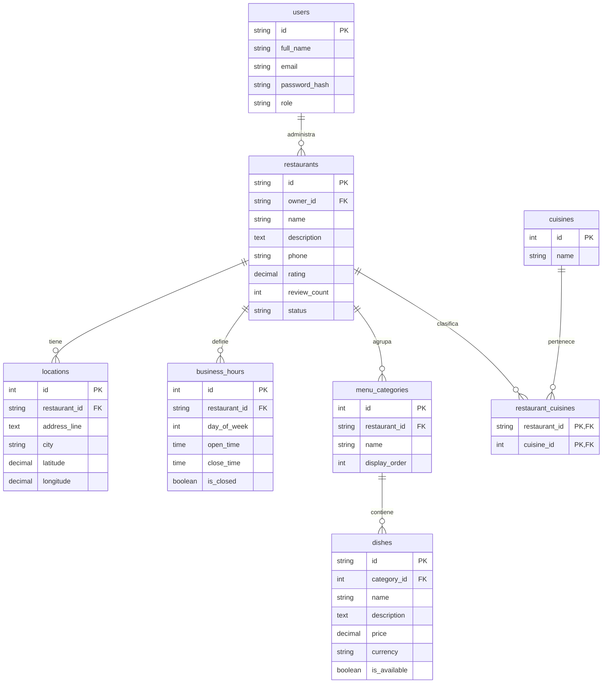
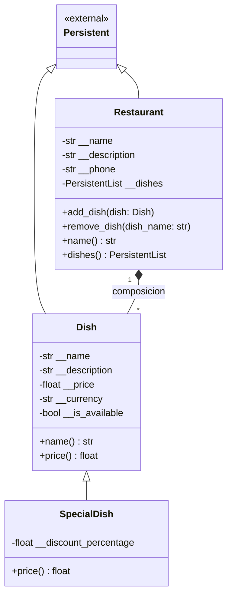
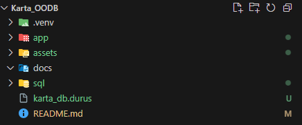
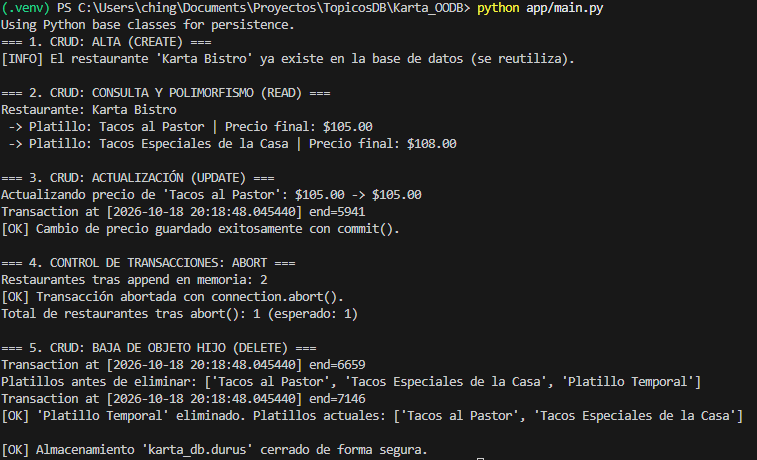
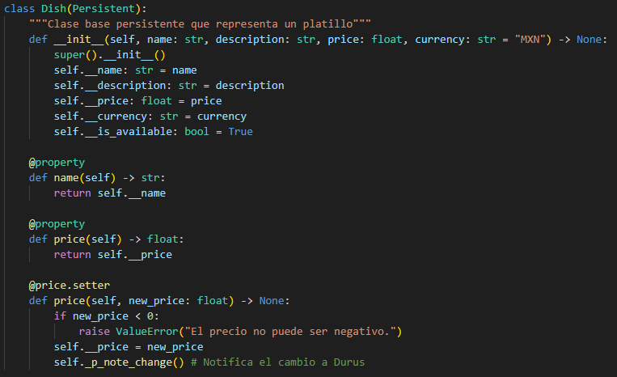
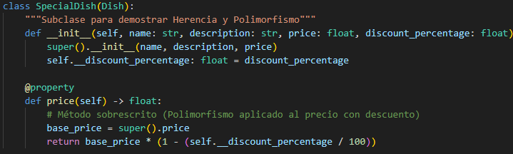
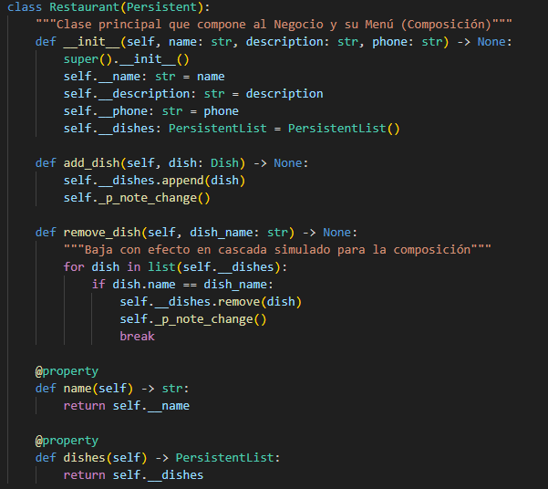
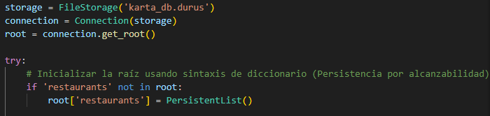
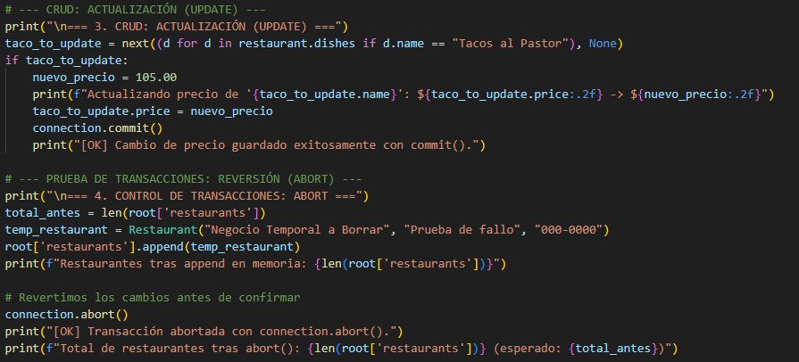
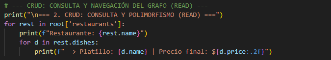

# Karta App - Práctica de Tópicos de Base de Datos. Modelo Relacional a Orientado Objetos.
Alumno: Teista García Cesar Gabriel  22211932 
Carrera: Ingeniería Informática.

## Descripcion General

Este repositorio contiene la implementacion practica de la arquitectura de datos desarrollada para **Karta App**, abarcando dos vertientes fundamentales de almacenamiento y gestion de informacion:

* **Parte I: Modelo Relacional Normalizado**, implementado en el sistema gestor de bases de datos relacionales **MySQL**.

* **Parte II: Modelo Orientado a Objetos Persistente**, implementado en **Python** utilizando el motor de base de datos orientada a objetos **Durus**, aplicando encapsulamiento, herencia, polimorfismo, composicion y control transaccional ACID.

---

## Estructura del Repositorio

* **`sql/`**: Contiene el script estructurado de definicion DDL y esquema relacional en MySQL (`KartaDB_RelationalModel.sql`).

* **`app/`**: Contiene el codigo fuente del modelo de objetos (`models.py`) y la logica transaccional del sistema (`main.py`).

* **`assets/`**: Contiene capturas de pantalla del código y respuesta de ejecución del script **main**  de python (`main.py`).

---

## Parte I: Modelo Relacional (MySQL)

El diseño relacional organiza la informacion bajo el motor de almacenamiento **InnoDB**, asegurando la integridad referencial estricta mediante el uso de llaves primarias (**PK**) y foraneas (**FK**) para la gestion integral de usuarios, negocios, ubicaciones geograficas, horarios de atencion y catalogos de platillos y tipos de cocina.

### Diagrama Entidad-Relacion



---

## Parte II: Base de Datos Orientada a Objetos (Python y Durus)

La implementacion orientada a objetos aprovecha la persistencia por alcanzabilidad (*persistence by reachability*) que ofrece **Durus**, eliminando el desfase de impedancia objeto-relacional (*Object-Relational Impedance Mismatch*). Esto permite manipular y navegar grafos complejos de objetos directamente en memoria y persistirlos de forma transaccional.

### Tabla de Correspondencia: Modelo Relacional a Clases Persistentes

| Elemento en MySQL (`.sql`) | Elemento en Durus (`models.py`) | Tipo de Transformación | Justificación Técnica |
| :--- | :--- | :--- | :--- |
| **`restaurants`** | **`Restaurant(Persistent)`** | Tabla a Clase Persistente | Se encapsulan atributos (`__name`, `__description`, `__phone`) y la identidad pasa de ser una clave primaria artificial a un OID interno inmutable. |
| **`dishes`** | **`Dish(Persistent)`** | Tabla a Clase Base Persistente | La tupla se convierte en objeto con validación de negocio en el setter de precio y métodos de acceso encapsulados. |
| *(Sin equivalente directo)* | **`SpecialDish(Dish)`** | Subclase con Polimorfismo | En SQL requiere columnas nulas o tablas de subtipo. En Durus se resuelve con herencia limpia y sobreescritura dinámica de `price`. |
| **`menu_categories`** | *(Eliminada)* | Absorción por Composición | En SQL normalizaba la relación 1:N con llaves foráneas. En Durus, `Restaurant` contiene directamente los objetos en `__dishes`. |
| **`CONSTRAINT fk_*`** | **`PersistentList`** | Claves Foráneas a Referencias Directas | La integridad y vinculación se mantiene mediante punteros en memoria y serialización transitiva del grafo. |

### Diagrama de Clases



### Consultas: Navegación del Grafo vs SQL Equivalente

#### Consulta 1: Listado de Restaurantes con sus Platillos Disponibles
* **Enfoque Orientado a Objetos (Navegación del Grafo):**
  ```python
  for rest in root['restaurants']:
      print(f"Restaurante: {rest.name}")
      for d in rest.dishes:
          print(f" -> Platillo: {d.name} | Precio: ${d.price:.2f}")
  ```
* **Enfoque Relacional Equivalente (SQL con JOINs):**
  ```sql
  SELECT r.name AS restaurante, d.name AS platillo, d.price AS precio
  FROM restaurants r
  JOIN menu_categories c ON c.restaurant_id = r.id
  JOIN dishes d ON d.category_id = c.id
  WHERE d.is_available = TRUE;
  ```

#### Consulta 2: Consulta Polimórfica de Precios con Descuento
* **Enfoque Orientado a Objetos (Polimorfismo en tiempo de ejecución):**
  ```python
  # Invoca automáticamente el método price de Dish o SpecialDish según corresponda
  platillos_baratos = [d for d in restaurant.dishes if d.price < 110.0]
  ```
* **Enfoque Relacional Equivalente (SQL con lógica condicional o UNION):**
  ```sql
  SELECT name, 
         CASE 
           WHEN discount_percentage IS NOT NULL THEN price * (1 - discount_percentage / 100)
           ELSE price 
         END AS final_price
  FROM dishes
  WHERE (CASE WHEN discount_percentage IS NOT NULL THEN price * (1 - discount_percentage / 100) ELSE price END) < 110.0;
  ```


### Nota Técnica: Mutabilidad de Colecciones y Notificación de Cambios en Durus

En el motor Durus, un objeto persistente solo se marca para sincronización en disco (`UNSAVED`) cuando se asigna directamente uno de sus atributos mediante `setattr` o cuando hereda el comportamiento base de `Persistent`.

Si dentro de una clase persistente se utiliza una lista o un diccionario nativo de Python (`list` o `dict`), las modificaciones internas como `.append()` o `dict[key] = value` ocurren a nivel de la estructura nativa sin pasar por el mecanismo de intercepción de Durus. Por lo tanto, **Durus no se entera del cambio y no lo guardará en el `commit()`**.

Para resolver este comportamiento y garantizar la persistencia de los cambios, se implementaron dos soluciones canónicas en este proyecto:

1. **Uso de Colecciones Persistentes Nativas (`PersistentList`):** Se utiliza `PersistentList` en `Restaurant.__dishes`, la cual hereda internamente de `Persistent` y notifica sus propias mutaciones automáticamente.

2. **Invocación explícita de `self._p_note_change()`:** En métodos como el setter `price` o en `add_dish()` y `remove_dish()`, se invoca `self._p_note_change()` para marcar manualmente el objeto contenedor como modificado y forzar a que Durus lo incluya en la transacción del siguiente `commit()`.


### Principios de Programacion Orientada a Objetos Aplicados

#### 1. Encapsulamiento
Los atributos internos de las clases estan definidos como privados (`__name`, `__price`, `__dishes`, etc.) y protegidos mediante decoradores `@property`. Las modificaciones se gestionan mediante *setters* que incorporan validaciones de negocio (por ejemplo, impidiendo precios negativos) y notifican a Durus el cambio de estado con `self._p_note_change()`.

#### 2. Herencia y Polimorfismo
La clase `SpecialDish` hereda de la clase base `Dish` y sobrescribe el calculo de la propiedad `price`. De este modo, al iterar de manera polimorfica sobre una coleccion generica de platillos, `SpecialDish` aplica dinamicamente un porcentaje de descuento sin necesidad de comprobaciones condicionales externas.

#### 3. Composicion
La clase `Restaurant` mantiene una relacion de pertenencia fuerte con sus platillos mediante la estructura persistente `PersistentList`. A traves del metodo `remove_dish()`, se implementa una simulacion de eliminacion en cascada dentro del grafo de objetos.

#### 4. Control Transaccional ACID
El motor Durus proporciona control transaccional nativo sobre el archivo de almacenamiento:
* **`commit()`**: Confirma los cambios realizados en el grafo de objetos en memoria y los sincroniza de manera permanente en el archivo de almacenamiento.
* **`abort()`**: Revierte cualquier mutacion o adicion en memoria al estado exacto de la ultima confirmacion transaccional.

---

## Ejecucion del Proyecto

### Requisitos Previos

* **Python 3.10 o superior**
* Paquetes de Python:
  * `durus`
  * `pywin32` (requerido para el bloqueo seguro de archivos en entornos Windows)

### Ejecucion de la Demostracion

Para iniciar la ejecucion de la base de datos orientada a objetos y verificar el ciclo transaccional completo:

```bash
python app/main.py
```

---

## Documentación técnica de la práctica Karta OODB

### Estructura de carpetas y archivos

Para mantener el proyecto ordenado y modular, organizamos los archivos según su propósito dentro del sistema:

* **`app/`**: Es la carpeta principal del código fuente en Python. Contiene `models.py` (donde definimos las clases de objetos persistentes como `Dish`, `SpecialDish` y `Restaurant`) y `main.py` (el script que arranca la base de datos, inicializa la raíz y ejecuta las pruebas de operaciones CRUD y transacciones).
* **`sql/`**: Aloja el script de base de datos relacional `KartaDB_RelationalModel.sql`. Representa el modelo inicial normalizado en MySQL, sirviendo como punto de comparación frente al modelo orientado a objetos.
* **`docs/`**: Carpeta designada para almacenar la documentación y el reporte formal de la práctica en formato PDF, pensado especialmente para quienes prefieran consultar o imprimir el trabajo fuera del entorno de GitHub.
* **`assets/`**: Almacena todas las capturas de pantalla, diagramas y evidencias visuales que respaldan la explicación técnica de este documento.
* **`.venv/`**: Es el entorno virtual de Python. Su función es aislar las dependencias del proyecto (como `durus` y `pywin32`) en un espacio cerrado e independiente, evitando conflictos con otras versiones o paquetes globales instalados en el sistema operativo.
* **`karta_db.durus`**: Es el archivo físico de la base de datos generado por Durus. A diferencia de MySQL que requiere un servidor corriendo en segundo plano, aquí toda la base de datos vive directamente dentro de este archivo binario donde se guardan los objetos serializados.



### Respuesta de ejecución de main.py

En esta captura se aprecia la corrida completa del script `python app/main.py` ejecutado dentro del entorno virtual `(.venv)`. En la salida de la terminal de PowerShell se comprueba paso a paso cómo responde el motor Durus en cada una de las fases programadas:

1. **ALTA (CREATE):** Se verifica de manera inteligente que el restaurante `'Karta Bistro'` ya existía en la base de datos, evitando crear duplicados innecesarios.
2. **CONSULTA Y POLIMORFISMO (READ):** Se recorre el menú mostrando los precios finales. Aquí destaca que `'Tacos Especiales de la Casa'` calcula en automático su precio con descuento ($108.00) gracias a su método polimórfico.
3. **ACTUALIZACIÓN (UPDATE):** Se modifica el precio del platillo base a $105.00 y se confirma con `commit()`, observándose el registro de la transacción en disco (`Transaction at [...] end=5941`).
4. **TRANSACCIONES (ABORT):** Se inserta en memoria un restaurante de prueba y se ejecuta `connection.abort()`, comprobando que el sistema descarta los cambios y mantiene intacto el conteo en 1 solo restaurante.
5. **BAJA (DELETE):** Se añade un platillo temporal y se elimina del menú con `remove_dish()`, confirmando su desaparición definitiva tras el commit.
6. **Cierre seguro:** El flujo concluye liberando los recursos y cerrando el archivo `karta_db.durus` de forma segura sin bloquear el descriptor de archivo en Windows.




### Clases Persistentes, Encapsulamiento y Abstracción

Aquí la clase **Dish** hereda directamente de `Persistent`, que es la clase base que nos da Durus para que cualquier objeto que instanciemos se pueda guardar en la base de datos sin pelearnos con consultas SQL manuales. Para proteger la información aplicamos encapsulamiento poniendo atributos privados con doble guion bajo (`__name`, `__price`, `__description`, etc.), evitando que se modifiquen directo desde fuera. 

Para leerlos usamos `@property`, y en el caso del precio definimos su respectivo `@price.setter`. Este setter valida que nadie le meta un precio negativo y, lo más importante, ejecuta `self._p_note_change()`, que es la instrucción con la que le decimos a Durus: *"este objeto acaba de cambiar de estado en memoria, tómalo en cuenta para guardarlo en el siguiente commit"*.



### Herencia y Polimorfismo

En este bloque creamos la subclase **SpecialDish** heredando de **Dish**. Esto nos permite reutilizar todo lo que ya tiene un platillo base (nombre, descripción, precio base) sin duplicar código, agregando únicamente el dato nuevo: el porcentaje de descuento (`__discount_percentage`).

Lo interesante aquí es cómo aplicamos el polimorfismo: sobrescribimos la propiedad `price` para que obtenga el precio original mediante `super().price` y le descuente el porcentaje correspondiente al vuelo. De esta manera, cuando en el `main.py` recorremos la lista de platillos con un simple ciclo `for`, a todos les pedimos `d.price` por igual y cada platillo sabe exactamente cómo calcular y devolver su precio final (sea normal o con promoción) sin tener que meter condicionales `if` para saber qué tipo de platillo es.



### Objetos Complejos y Composición

En el mundo relacional de MySQL teníamos que conectar restaurantes y platillos usando llaves foráneas (`FK`) y después armar consultas con `JOIN` para reconstruir la información. En este modelo orientado a objetos eso desaparece gracias a los objetos complejos y la composición: la clase **Restaurant** tiene adentro su propio atributo `__dishes` que es una `PersistentList()`, una lista persistente propia de Durus que guarda directamente las instancias de `Dish`.

El restaurante es el dueño de sus platillos: con el método `add_dish()` vamos armando el grafo de objetos enlazados en memoria, y con `remove_dish()` podemos dar de baja un platillo por su nombre. Durus se encarga de serializar y guardar toda esta jerarquía completa con un solo `commit()`.



### Persistencia por Alcanzabilidad

La persistencia por alcanzabilidad significa que no tenemos que preocuparnos por guardar cada objeto uno por uno a mano. Durus nos da un objeto principal llamado `root`, que se comporta como un diccionario gigante y sirve como la puerta de entrada a toda la base de datos.

Cualquier objeto que conectemos a esa raíz queda automáticamente 'alcanzable'. En nuestro código enganchamos la lista `restaurants` al `root`, luego agregamos el restaurante `Karta Bistro` a esa lista, y a su vez ese restaurante ya contiene sus platillos adentro. Al ejecutar `connection.commit()`, Durus recorre toda esa cadenita de objetos enlazados y los guarda juntos en el archivo `.durus` sin que tengamos que hacer consultas `INSERT` individuales para cada elemento.



### Transacciones

Las transacciones en Durus se rigen por la regla de 'todo o nada'. Cuando usamos `connection.commit()`, le indicamos al sistema que guarde de forma definitiva y permanente todos los cambios que tenemos en memoria hacia el archivo de la base de datos.

Para comprobar cómo se protegen los datos ante imprevistos, usamos `connection.abort()`. En la prueba añadimos a la lista un restaurante temporal ('Negocio Temporal a Borrar') y de inmediato cancelamos la transacción. Lo que hace Durus es como un 'Ctrl + Z': descarta al instante las modificaciones hechas en memoria y regresa la lista exactamente al estado del último commit confirmado, asegurando que si algo falla el archivo nunca quede con datos incompletos o corruptos.



### Navegación del Grafo

Navegar el grafo significa movernos entre los datos usando simplemente la sintaxis de puntos (`.`) de Python, exactamente igual a como interactuamos con cualquier objeto común en memoria y olvidándonos por completo de escribir consultas `SELECT` con `JOIN`.

Partimos de la raíz `root['restaurants']`, recorremos cada restaurante con un ciclo `for rest in ...`, leemos sus datos con `rest.name`, y desde ahí brincamos directo a su lista de platillos con `for d in rest.dishes`. Durus se encarga por detrás de traer los datos del disco conforme los vamos solicitando, permitiéndonos explorar relaciones complejas de manera totalmente limpia y natural.




---

## Pero ¿Cómo funciona Durus exactamente?

Para entender qué hace Durus por detrás, conviene analizarlo a la luz de los conceptos teóricos de la materia (**Sistemas de Bases de Datos Orientadas a Objetos - Unidad 2**).

### 1. ¿Qué es lo que logra Durus?

En el desarrollo de software tradicional existe un problema clásico conocido como **desfase de impedancia objeto-relacional** (*Object-Relational Impedance Mismatch*). Este choque ocurre porque, como programadores en Python, pensamos y modelamos la realidad en forma de **objetos, clases, listas y métodos**. Sin embargo, las bases de datos relacionales tradicionales (como MySQL) nos obligan a desarmar esos objetos para encajarlos a la fuerza en tablas planas con filas, columnas y tipos simples, forzándonos a escribir sentencias SQL y múltiples `JOIN` para volver a unirlos.

**Lo que logra Durus es eliminar esa barrera por completo.** Se trata de un motor de base de datos orientada a objetos pura (OODBMS) para Python con una filosofía minimalista: permite que los objetos de Python se almacenen en el disco duro exactamente como existen en la memoria RAM, sin convertirlos a tablas y sin necesidad de escribir una sola línea de SQL.

### 2. ¿Cómo lo hace por dentro?

El funcionamiento interno de Durus se apoya en varios mecanismos clave que la teoría de bases de datos orientadas a objetos describe:

* **La clase base `Persistent` y la Identidad de Objetos (OID):**
  A diferencia de una base relacional donde la identidad de un registro depende del valor de su clave primaria (por ejemplo, un `id` entero), en Durus cada objeto que hereda de `Persistent` recibe un **OID** (*Object Identifier*) único e inmutable asignado por el motor. Esto significa que dos platillos pueden tener exactamente el mismo nombre y precio, pero Durus sabe que son dos entidades distintas porque tienen OIDs diferentes.

* **Persistencia por Alcanzabilidad (*Persistence by Reachability*):**
  Durus no requiere que guardemos cada objeto de forma individual. En su lugar, nos entrega un objeto raíz llamado `root` (que funciona como el tronco principal de un árbol). Si conectamos un objeto a esa raíz (en nuestro caso, la lista de restaurantes), cualquier otro objeto que esté enlazado a él (como los platillos de cada restaurante) pasa a ser persistente de forma automática.

* **Detección de cambios y serialización:**
  Cuando modificamos un atributo (por ejemplo, al actualizar el precio de un taco en el setter con `self._p_note_change()`), el objeto le avisa a Durus que su estado en memoria cambió. Al invocar `connection.commit()`, Durus toma esos objetos modificados, los serializa usando una versión interna optimizada del protocolo *pickle* de Python y los escribe de forma atómica en el archivo físico `.durus`.

* **Carga bajo demanda (*Ghosting* o activación diferida):**
  Al abrir la base de datos, Durus no carga gigabytes de información a la memoria de golpe. Mantiene referencias ligeras y únicamente va al disco a leer y "despertar" el estado completo de un objeto cuando en nuestro código realmente intentamos acceder a sus atributos (por ejemplo, al recorrer `for d in rest.dishes`).

* **Transacciones ACID nativas:**
  Durus ofrece control transaccional estricto dentro del proceso. Si todas las operaciones salen bien, llamamos a `connection.commit()` y los cambios quedan grabados de forma permanente. Si algo falla o decidimos cancelar, `connection.abort()` actúa como un "Ctrl + Z", descartando las modificaciones en memoria y regresando todo al estado del último commit seguro. El **control transaccional mediante Durus garantiza la atomicidad y consistencia de los datos en memoria antes de consolidarlos en disco** . Si durante la ejecución de un flujo de operaciones (como un registro masivo o una actualización dependiente) se detecta una inconsistencia o un fallo lógico, el método connection.abort() permite descartar de manera segura todas las modificaciones realizadas en el grafo de objetos en memoria, evitando que estados parciales o erróneos corrompan el almacenamiento persistente.

---

### 3. ¿Qué temas de la materia aborda esta práctica?

Esta práctica cubre de manera práctica e integrada los temas centrales de la **Unidad 2: Sistemas de Bases de Datos Orientadas a Objetos**:

1. **Superación del Modelo Relacional:** Demostración de cómo se sustituye el esquema relacional fragmentado de MySQL por un modelo orientado a objetos directo y navegable en memoria:

   * **De la tabla `restaurants` a la clase persistente `Restaurant`:** En MySQL, un negocio dependía de claves primarias artificiales (`id CHAR(36)`), claves foráneas (`owner_id`) y atributos atómicos planos. En Durus se convierte en una clase persistente con estado encapsulado (`__name`, `__description`, `__phone`) identificada de manera unívoca por su OID nativo.

   * **De la tabla `dishes` a la clase persistente `Dish` y `SpecialDish`:** En lugar de guardar filas planas dependientes de claves foráneas, los platillos pasan a ser objetos autónomos con métodos y validaciones propias. Además, la necesidad de meter columnas opcionales o tablas extra para promociones se resuelve de forma limpia mediante herencia con la subclase `SpecialDish`.

   * **Eliminación de tablas intermedias y llaves foráneas (`menu_categories`, FKs):** En el modelo relacional era obligatorio crear tablas intermedias como `menu_categories` y enlazar claves foráneas (`restaurant_id`, `category_id`) para poder reconstruir un menú mediante sentencias `JOIN`. En Durus esa tabla intermedia desaparece: el restaurante contiene directamente a sus platillos en memoria mediante una relación de composición natural usando `PersistentList`.
   
   * **Catálogos y tablas satélite:** Tablas del SQL como `locations`, `business_hours` o la tabla puente `restaurant_cuisines` —que en MySQL se crearon para cumplir la Primera Forma Normal (1FN) y normalizar el esquema— dejan de necesitar tablas puente o relaciones foráneas rígidas, ya que el paradigma de objetos permite anidar atributos complejos y colecciones directamente dentro de la entidad principal.


2. **Los Cuatro Pilares de la POO en Bases de Datos:**

   * **Abstracción:** Representación de entidades del negocio culinario exponiendo solo sus propiedades esenciales.

   * **Encapsulamiento:** Protección de datos mediante atributos privados (`__name`, `__price`) y validación de reglas de negocio en los setters.

   * **Herencia y Polimorfismo:** Especialización de `Dish` en `SpecialDish`, permitiendo que el cálculo del precio con descuento se resuelva dinámicamente en tiempo de ejecución sin condicionales externos.

   * **Composición y Objetos Complejos:** Uso de colecciones anidadas nativas (`PersistentList`) para modelar la relación fuerte entre un restaurante y su menú, con simulación de bajas en cascada.

3. **Mecanismos de Persistencia:** Aplicación real de la persistencia por alcance frente a la persistencia clásica por filas.

4. **Ciclo Transaccional e Integridad:** Verificación empírica de operaciones de alta (`CREATE`), consulta (`READ`), modificación (`UPDATE`), baja (`DELETE`), confirmación (`commit`) y reversión segura (`abort`).

